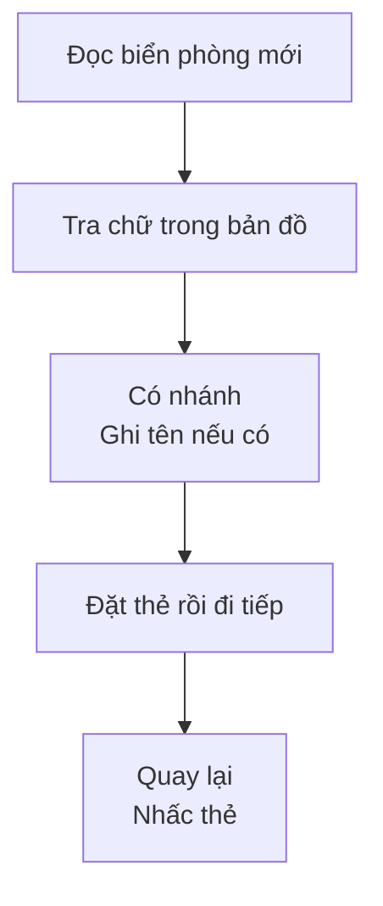
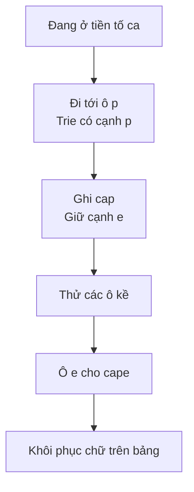

> [!tldr] Đọc nhanh
> - Dò từng từ bằng [[concepts/backtracking|quay lui]] là mốc dễ kiểm tra. Các từ chung tiền tố có thể lặp lại cùng đoạn đường.
> - Mang theo nút [[concepts/trie|trie]] trong mỗi lời gọi để biết tiền tố có từ nào đi tiếp. Cạnh con thiếu thì dừng ngay tại ô đó.
> - Đánh dấu ô trong phạm vi đường hiện tại rồi khôi phục khi quay về. Sau khi ghi nhận một từ, xóa [[concepts/terminal-marker|dấu kết thúc từ]] cho cả lượt tìm.
> - Giữ nhánh còn chứa từ chưa ra kết quả. Xóa cạnh khi nút con hết cả từ lẫn hậu duệ cần tìm.

> [!info] Bối cảnh
> Bài LeetCode 212 (Hard) thuộc [[posts/2026-11-26-neetcode-trie|ga 7: Trie]] trên **tuyến NeetCode: Cấu trúc liên kết**. [[problems/implement-trie-prefix-tree|LC-0208]] dùng trie để trả lời câu hỏi về một chuỗi. Bài này tự xây chuỗi khi đi trên bảng nên cần giữ đồng thời hai trạng thái, vị trí trong trie và các ô đã dùng. Bạn chỉ cần biết chỉ số hàng, cột và bốn hướng kề ô.

> [!abstract]- Từ điển nhanh cho bài này (bấm để mở)
> - **Tiền tố** của `cape` là các đoạn bắt đầu từ đầu từ, chẳng hạn `ca` hoặc `cap`.
> - **Dấu kết thúc từ** nằm ở một nút trie khi đường từ gốc tới nút tạo thành một từ trong danh sách. Ở đây nút lưu luôn chuỗi đầy đủ.
> - **Duyệt theo chiều sâu (DFS)** đi sâu trên một lựa chọn rồi quay lại thử lựa chọn khác.
> - **Cắt theo tiền tố** ([[concepts/trie-prefix-pruning|prefix pruning]]) bỏ một đường khi không còn từ cần tìm bắt đầu bằng chữ đã đi qua.
> - **Giá trị canh** `#` tạm thay chữ ở ô đã dùng trên cùng đường. Đề chỉ cho chữ thường tiếng Anh nên `#` không trùng chữ hợp lệ.

## Hình dung trước: dò biển chữ trong một bảo tàng

Mỗi phòng có một biển chữ. Mình đi qua cửa nối các phòng để đọc thành tên hiện vật. Khách giữ một tấm bản đồ tra tên theo từng chữ, đặt thẻ tạm ở phòng đã ghé và nhấc thẻ khi bước lùi. Khi tìm thấy tên, quầy kiểm kê gạch tên ấy khỏi danh sách dù khách có thể tìm thêm một lối khác tới cùng tên.

| Đời thường | Khái niệm |
|---|---|
| Cửa giữa hai phòng chung tường | Kề ngang hoặc dọc |
| Thẻ tạm đặt ở phòng đã ghé | Đánh dấu ô trên đường hiện tại |
| Bản đồ tra tên, một nhánh cho mỗi chữ | Trie chứa từ cần tìm |
| Bản đồ hết lối khi đọc thêm một chữ | Cắt theo tiền tố |
| Gạch đúng tên vừa tìm | Xóa dấu kết thúc từ |
| Ngăn tra hết tên chưa tìm thì tháo ngăn | Xóa nhánh trie đã cạn |



## Vấn đề: nhiều từ chung một đoạn đường

Cho bảng chữ `m × n` với mỗi chiều từ 1 đến 12 và danh sách từ phân biệt có từ 1 đến 30 000 mục. Mỗi từ dài từ 1 đến 10. Bảng và từ đều dùng chữ thường tiếng Anh. Trả về mỗi từ có thể đọc từ một đường đi kề ngang hoặc dọc, với mỗi ô được dùng nhiều nhất một lần trên đường đó. [Đề LeetCode 212](https://leetcode.com/problems/word-search-ii/)

Thử bảng sau và danh sách `cap, cape, car, cart, capa, cat`.

```text
c a r
t p x
x e x
```

Đường `c → a → p` cho `cap`, rồi từ `p` xuống `e` cho `cape`. Rẽ sang `r` từ `a` cho `car`. Từ `capa` cần quay lại ô `a` đã dùng, còn `cat` cần từ `a` bước chéo sang `t`. `cart` cũng dừng ở `r` vì không có `t` bên cạnh. Vậy kết quả gồm `cap, cape, car`. Dò từng từ sẽ thử lại `c → a` nhiều lần.

## Cơ chế

### Cách 1 — Tìm mỗi từ bằng một lượt quay lui

Với mỗi từ, lần lượt thử xuất phát tại mọi ô. Lời gọi giữ vị trí ký tự đang cần. Nếu ô sai chữ hoặc vượt biên thì dừng. Khi ô khớp, đánh dấu nó rồi thử bốn hàng xóm với vị trí ký tự kế tiếp. Trước khi trả kết quả cho lời gọi cha, khôi phục chữ cũ. Khi đã khớp hết từ thì dừng lượt tìm của từ đó, vì bài chỉ cần biết có ít nhất một đường.

Việc đánh dấu có phạm vi của **một đường đang thử**. Cùng ô `a` có thể xuất hiện trong đường tạo `cap` và đường khác tạo `car`. Khôi phục ô giúp lượt rẽ sang `r` vẫn thấy chữ `a` khi bắt đầu lại từ `c`.

### Cách 2 — Dùng trie để một đường phục vụ nhiều từ

Chèn toàn bộ danh sách vào trie. Đường `c → a` trong bảng đi cùng nút `ca` trong trie. Ở mỗi lời gọi, nút cha đại diện cho các chữ đã khớp và ô sắp xét cung cấp chữ tiếp theo. Ô `p` dẫn tới nút `cap`, có cả từ hoàn chỉnh `cap` và cạnh `e` để tìm `cape`. Ô có chữ ngoài các cạnh con thì không thể dẫn tới từ hợp lệ, nên mình dừng trước khi mở thêm bốn lời gọi.



Hai thao tác sau có phạm vi khác nhau.

1. Ghi từ vào kết quả rồi xóa dấu kết thúc từ. Từ `cap` đã có một đường hợp lệ nên mọi đường về sau đều có thể bỏ qua thao tác ghi `cap`. Node vẫn giữ các cạnh con.
2. Khi quay về, nếu nút hết cạnh con, xóa nó khỏi nút cha. Lúc này từ ở chính nút đã được ghi nếu có, và mọi từ bên dưới đều đã được tìm. Cạnh cha bỏ đi không thể loại một đáp án còn thiếu.

Để thấy vì sao cách này tìm đủ, xét một đường tạo ra từ còn thiếu. Mỗi bước tiếp theo của đường có cạnh tương ứng trong trie vì việc xóa nhánh chỉ chạm phần đã cạn. Từ ô đầu, DFS thử đủ các hàng xóm hợp lệ và không dùng lại một ô trên cùng đường. Nó sẽ tới dấu kết thúc của từ đó, trừ trường hợp một đường khác đã đưa từ vào kết quả trước.

### Chi phí và số bước thực đo

Đặt `B = m × n`, `S` là tổng độ dài từ, `P` là số nút trie và `D` là giá trị nhỏ hơn giữa `B` và độ dài từ lớn nhất, tức cận trên cho độ sâu một đường đang thử. Từ một ô, bước thứ hai có tối đa bốn lựa chọn. Các bước sau có tối đa ba vì ô ngay trước luôn bị đánh dấu. Cạnh biên, ô đã dùng và chữ không khớp tiếp tục giảm số lựa chọn thực.

| Cách | Thời gian | Bộ nhớ phụ, ngoài kết quả |
|---|---|---|
| Từng từ | Cộng `O(B · 3^d)` qua từng từ, với `d` là giá trị nhỏ hơn giữa độ dài từ và `B` | `O(D)` cho ngăn xếp gọi hàm |
| Trie | `O(S + B · 3^D)` là cận trên. Khi chạy, phần dò là `O(B + A)` với `A` là số bước khớp thực tế | `O(P + D)` với `P ≤ S + 1` |

Bảng dùng alphabet cố định 26 chữ nên mỗi nút có số cạnh con bị chặn. Mỗi bước khớp làm tối đa bốn lần gọi hàng xóm, và mỗi ô được thử một lần ở gốc. Vì vậy có thể đo số bước khớp mà vẫn hiểu số lần thăm phát sinh. Trie giảm công dò lặp, nhưng số đường trong trường hợp xấu vẫn tăng nhanh theo `D`.

Ca đo dùng bảng `3 × 3` toàn chữ `a` và mười từ bắt đầu bằng `aaaaa`, kết thúc bằng một chữ từ `b` đến `k`. Hai cách đều trả về danh sách rỗng. Dò từng từ khớp **2 610** bước, còn trie khớp **261** bước vì chia sẻ phần `aaaaa`. Số đếm tăng sau khi ăn được một ký tự. Nó đo đúng phần đường đã khớp, còn dựng trie, so sánh thất bại và chi phí cấp phát nằm ngoài số đếm. Đây là ca cố ý làm trùng tiền tố để thấy lợi ích chia sẻ, nên tỷ lệ 10 lần không phải tỷ lệ thời gian chung.

## Ví dụ chạy được

Hai cách chạy trên cùng sáu ca, gồm từ là tiền tố của từ khác, nhiều đường cho cùng từ, bước chéo bị loại và từ cần dùng lại ô. Năm ca nhỏ còn kiểm tra bảng được khôi phục nguyên vẹn sau mỗi cách.

Tải [TypeScript](../code/neetcode-word-search-ii/search-grid.ts), [Python](../code/neetcode-word-search-ii/search-grid.py), [Go](../code/neetcode-word-search-ii/search-grid.go), [Java](../code/neetcode-word-search-ii/search-grid.java) hoặc [JavaScript](../code/neetcode-word-search-ii/search-grid.js). Chạy bằng `node search-grid.ts`, `python3 search-grid.py`, `go run search-grid.go`, `java search-grid.java` hoặc `node search-grid.js`.

```ts
const directions = [[0, 1], [1, 0], [0, -1], [-1, 0]]

type SearchRun = { found: string[]; advances: number }
type TrieNode = { children: Map<string, TrieNode>; word?: string }

function perWord(board: string[][], words: string[]): SearchRun {
  const rows = board.length
  const cols = board[0].length
  const found: string[] = []
  let advances = 0

  function match(row: number, col: number, word: string, index: number): boolean {
    if (row < 0 || row >= rows || col < 0 || col >= cols) return false
    if (board[row][col] !== word[index]) return false
    advances++
    if (index + 1 === word.length) return true

    const letter = board[row][col]
    board[row][col] = "#"
    const hit = directions.some(([dr, dc]) => match(row + dr, col + dc, word, index + 1))
    board[row][col] = letter
    return hit
  }

  for (const word of words) {
    if (board.some((line, row) => line.some((_, col) => match(row, col, word, 0)))) {
      found.push(word)
    }
  }
  return { found, advances }
}

function withTrie(board: string[][], words: string[]): SearchRun {
  const root: TrieNode = { children: new Map() }
  for (const word of words) {
    let node = root
    for (const letter of word) {
      let child = node.children.get(letter)
      if (!child) {
        child = { children: new Map() }
        node.children.set(letter, child)
      }
      node = child
    }
    node.word = word
  }

  const rows = board.length
  const cols = board[0].length
  const found: string[] = []
  let advances = 0

  function visit(row: number, col: number, parent: TrieNode) {
    if (row < 0 || row >= rows || col < 0 || col >= cols) return
    const letter = board[row][col]
    const node = parent.children.get(letter)
    if (!node) return
    advances++

    if (node.word !== undefined) {
      found.push(node.word)
      delete node.word
    }
    board[row][col] = "#"
    for (const [dr, dc] of directions) {
      if (!node.children.size) break
      visit(row + dr, col + dc, node)
    }
    board[row][col] = letter
    if (!node.children.size) parent.children.delete(letter)
  }

  for (let row = 0; row < rows; row++) {
    for (let col = 0; col < cols; col++) visit(row, col, root)
  }
  return { found, advances }
}

const cases = [
  [["car", "tpx", "xex"], ["cap", "cape", "car", "cart", "capa", "cat"], ["cap", "cape", "car"]],
  [["aaa"], ["a", "aa", "aaa", "aaaa"], ["a", "aa", "aaa"]],
  [["ax", "xb"], ["ab", "axb", "axxb"], ["axb"]],
  [["z"], ["a", "z", "zz"], ["z"]],
  [["yx", "xy"], ["aaa", "zzz"], []],
]

for (const [rows, words, expected] of cases) {
  const board = rows.map(row => [...row])
  for (const search of [perWord, withTrie]) {
    const { found } = search(board, words)
    if (found.sort().join(",") !== expected.join(",")) throw new Error("Sai kết quả")
    if (board.map(row => row.join("")).join(",") !== rows.join(",")) {
      throw new Error("Bảng chữ đã thay đổi")
    }
  }
}

const board = Array.from({ length: 3 }, () => [..."aaa"])
const words = [..."bcdefghijk"].map(last => "aaaaa" + last)
const left = perWord(board, words)
const right = withTrie(board, words)
if (left.found.length || right.found.length || !right.advances || left.advances !== 10 * right.advances) {
  throw new Error("Sai số bước khớp")
}
console.log((cases.length + 1) + "/" + (cases.length + 1) + " ca đúng")
console.log("Bước khớp: " + left.advances + " / " + right.advances)
```
```python
DIRECTIONS = ((0, 1), (1, 0), (0, -1), (-1, 0))


def per_word(board, words):
    rows, cols = len(board), len(board[0])
    found = []
    advances = 0

    def match(row, col, word, index):
        nonlocal advances
        if not (0 <= row < rows and 0 <= col < cols):
            return False
        if board[row][col] != word[index]:
            return False
        advances += 1
        if index + 1 == len(word):
            return True
        letter = board[row][col]
        board[row][col] = "#"
        hit = any(
            match(row + dr, col + dc, word, index + 1)
            for dr, dc in DIRECTIONS
        )
        board[row][col] = letter
        return hit

    for word in words:
        if any(match(r, c, word, 0) for r in range(rows) for c in range(cols)):
            found.append(word)
    return found, advances


class Node:
    def __init__(self):
        self.children = {}
        self.word = None


def with_trie(board, words):
    root = Node()
    for word in words:
        node = root
        for letter in word:
            if letter not in node.children:
                node.children[letter] = Node()
            node = node.children[letter]
        node.word = word

    rows, cols = len(board), len(board[0])
    found = []
    advances = 0

    def visit(row, col, parent):
        nonlocal advances
        if not (0 <= row < rows and 0 <= col < cols):
            return
        letter = board[row][col]
        node = parent.children.get(letter)
        if node is None:
            return
        advances += 1
        if node.word is not None:
            found.append(node.word)
            node.word = None
        board[row][col] = "#"
        for dr, dc in DIRECTIONS:
            if not node.children:
                break
            visit(row + dr, col + dc, node)
        board[row][col] = letter
        if not node.children:
            del parent.children[letter]

    for row in range(rows):
        for col in range(cols):
            visit(row, col, root)
    return found, advances


CASES = [
    (["car", "tpx", "xex"], ["cap", "cape", "car", "cart", "capa", "cat"], ["cap", "cape", "car"]),
    (["aaa"], ["a", "aa", "aaa", "aaaa"], ["a", "aa", "aaa"]),
    (["ax", "xb"], ["ab", "axb", "axxb"], ["axb"]),
    (["z"], ["a", "z", "zz"], ["z"]),
    (["yx", "xy"], ["aaa", "zzz"], []),
]

for rows, words, expected in CASES:
    board = [list(row) for row in rows]
    for search in (per_word, with_trie):
        found, _ = search(board, words)
        assert sorted(found) == expected
        assert ["".join(row) for row in board] == rows

board = [list("aaa") for _ in range(3)]
words = ["aaaaa" + last for last in "bcdefghijk"]
left, separate = per_word(board, words)
right, shared = with_trie(board, words)
assert not left and not right and separate == 10 * shared and shared > 0
print(f"{len(CASES) + 1}/{len(CASES) + 1} ca đúng")
print(f"Bước khớp: {separate} / {shared}")
```
```go
package main

import (
	"fmt"
	"slices"
	"strings"
)

var directions = [][2]int{{0, 1}, {1, 0}, {0, -1}, {-1, 0}}

type result struct {
	found    []string
	advances int
}

func perWord(board [][]byte, words []string) result {
	rows, cols := len(board), len(board[0])
	out := result{}
	var match func(int, int, string, int) bool
	match = func(row, col int, word string, index int) bool {
		if row < 0 || row >= rows || col < 0 || col >= cols {
			return false
		}
		letter := board[row][col]
		if letter != word[index] {
			return false
		}
		out.advances++
		if index+1 == len(word) {
			return true
		}

		board[row][col] = '#'
		hit := false
		for _, dir := range directions {
			if match(row+dir[0], col+dir[1], word, index+1) {
				hit = true
				break
			}
		}
		board[row][col] = letter
		return hit
	}

wordsLoop:
	for _, word := range words {
		for row := range rows {
			for col := range cols {
				if match(row, col, word, 0) {
					out.found = append(out.found, word)
					continue wordsLoop
				}
			}
		}
	}
	return out
}

type node struct {
	children map[byte]*node
	word     string
}

func withTrie(board [][]byte, words []string) result {
	root := &node{children: make(map[byte]*node)}
	for _, word := range words {
		parent := root
		for index := range len(word) {
			letter := word[index]
			child := parent.children[letter]
			if child == nil {
				child = &node{children: make(map[byte]*node)}
				parent.children[letter] = child
			}
			parent = child
		}
		parent.word = word
	}

	rows, cols := len(board), len(board[0])
	out := result{}
	var visit func(int, int, *node)
	visit = func(row, col int, parent *node) {
		if row < 0 || row >= rows || col < 0 || col >= cols {
			return
		}
		letter := board[row][col]
		child := parent.children[letter]
		if child == nil {
			return
		}
		out.advances++
		if child.word != "" {
			out.found = append(out.found, child.word)
			child.word = ""
		}
		board[row][col] = '#'
		for _, dir := range directions {
			if len(child.children) == 0 {
				break
			}
			visit(row+dir[0], col+dir[1], child)
		}
		board[row][col] = letter
		if len(child.children) == 0 {
			delete(parent.children, letter)
		}
	}

	for row := range rows {
		for col := range cols {
			visit(row, col, root)
		}
	}
	return out
}

func makeBoard(rows []string) [][]byte {
	board := make([][]byte, len(rows))
	for index, row := range rows {
		board[index] = []byte(row)
	}
	return board
}

func main() {
	cases := []struct{ rows, words, expected []string }{
		{[]string{"car", "tpx", "xex"}, []string{"cap", "cape", "car", "cart", "capa", "cat"}, []string{"cap", "cape", "car"}},
		{[]string{"aaa"}, []string{"a", "aa", "aaa", "aaaa"}, []string{"a", "aa", "aaa"}},
		{[]string{"ax", "xb"}, []string{"ab", "axb", "axxb"}, []string{"axb"}},
		{[]string{"z"}, []string{"a", "z", "zz"}, []string{"z"}},
		{[]string{"yx", "xy"}, []string{"aaa", "zzz"}, nil},
	}
	for _, fixture := range cases {
		board := makeBoard(fixture.rows)
		for _, search := range []func([][]byte, []string) result{perWord, withTrie} {
			found := search(board, fixture.words).found
			slices.Sort(found)
			if !slices.Equal(found, fixture.expected) {
				panic("Sai kết quả")
			}
			for index, row := range board {
				if string(row) != fixture.rows[index] {
					panic("Bảng chữ đã thay đổi")
				}
			}
		}
	}

	board := makeBoard([]string{"aaa", "aaa", "aaa"})
	var words []string
	for _, last := range strings.Split("bcdefghijk", "") {
		words = append(words, "aaaaa"+last)
	}
	left, right := perWord(board, words), withTrie(board, words)
	if len(left.found) != 0 || len(right.found) != 0 || right.advances == 0 || left.advances != 10*right.advances {
		panic("Sai số bước khớp")
	}
	fmt.Printf("%d/%d ca đúng\n", len(cases)+1, len(cases)+1)
	fmt.Printf("Bước khớp: %d / %d\n", left.advances, right.advances)
}
```
```java
import java.util.ArrayList;
import java.util.Arrays;
import java.util.HashMap;
import java.util.List;
import java.util.Map;

class SearchGrid {
    private static final int[][] DIRECTIONS = {{0, 1}, {1, 0}, {0, -1}, {-1, 0}};

    private static final class Result {
        final List<String> found = new ArrayList<>();
        int advances;
    }

    static Result perWord(char[][] board, List<String> words) {
        Result out = new Result();
        wordsLoop:
        for (String word : words) {
            for (int row = 0; row < board.length; row++) {
                for (int col = 0; col < board[0].length; col++) {
                    if (match(board, row, col, word, 0, out)) {
                        out.found.add(word);
                        continue wordsLoop;
                    }
                }
            }
        }
        return out;
    }

    private static boolean match(char[][] board, int row, int col, String word, int index, Result out) {
        if (row < 0 || row >= board.length || col < 0 || col >= board[0].length) return false;
        char letter = board[row][col];
        if (letter != word.charAt(index)) return false;
        out.advances++;
        if (index + 1 == word.length()) return true;

        board[row][col] = '#';
        boolean hit = false;
        for (int[] dir : DIRECTIONS) {
            if (match(board, row + dir[0], col + dir[1], word, index + 1, out)) {
                hit = true;
                break;
            }
        }
        board[row][col] = letter;
        return hit;
    }

    private static final class Node {
        final Map<Character, Node> children = new HashMap<>();
        String word;
    }

    static Result withTrie(char[][] board, List<String> words) {
        Node root = new Node();
        for (String word : words) {
            Node node = root;
            for (int index = 0; index < word.length(); index++) {
                node = node.children.computeIfAbsent(word.charAt(index), unused -> new Node());
            }
            node.word = word;
        }

        Result out = new Result();
        for (int row = 0; row < board.length; row++) {
            for (int col = 0; col < board[0].length; col++) {
                visit(board, row, col, root, out);
            }
        }
        return out;
    }

    private static void visit(char[][] board, int row, int col, Node parent, Result out) {
        if (row < 0 || row >= board.length || col < 0 || col >= board[0].length) return;
        char letter = board[row][col];
        Node node = parent.children.get(letter);
        if (node == null) return;
        out.advances++;
        if (node.word != null) {
            out.found.add(node.word);
            node.word = null;
        }
        board[row][col] = '#';
        for (int[] dir : DIRECTIONS) {
            if (node.children.isEmpty()) break;
            visit(board, row + dir[0], col + dir[1], node, out);
        }
        board[row][col] = letter;
        if (node.children.isEmpty()) parent.children.remove(letter);
    }

    private record Fixture(List<String> rows, List<String> words, List<String> expected) {}

    private static char[][] makeBoard(List<String> rows) {
        return rows.stream().map(String::toCharArray).toArray(char[][]::new);
    }

    private static void check(Result out, char[][] board, Fixture fixture) {
        out.found.sort(String::compareTo);
        if (!out.found.equals(fixture.expected())) throw new AssertionError("Sai kết quả");
        if (!Arrays.deepEquals(board, makeBoard(fixture.rows()))) {
            throw new AssertionError("Bảng chữ đã thay đổi");
        }
    }

    public static void main(String[] args) {
        var cases = List.of(
            new Fixture(List.of("car", "tpx", "xex"), List.of("cap", "cape", "car", "cart", "capa", "cat"), List.of("cap", "cape", "car")),
            new Fixture(List.of("aaa"), List.of("a", "aa", "aaa", "aaaa"), List.of("a", "aa", "aaa")),
            new Fixture(List.of("ax", "xb"), List.of("ab", "axb", "axxb"), List.of("axb")),
            new Fixture(List.of("z"), List.of("a", "z", "zz"), List.of("z")),
            new Fixture(List.of("yx", "xy"), List.of("aaa", "zzz"), List.of())
        );
        for (Fixture fixture : cases) {
            char[][] board = makeBoard(fixture.rows());
            check(perWord(board, fixture.words()), board, fixture);
            check(withTrie(board, fixture.words()), board, fixture);
        }

        char[][] board = makeBoard(List.of("aaa", "aaa", "aaa"));
        List<String> words = new ArrayList<>();
        for (char last = 'b'; last <= 'k'; last++) words.add("aaaaa" + last);
        Result left = perWord(board, words);
        Result right = withTrie(board, words);
        if (!left.found.isEmpty() || !right.found.isEmpty() || right.advances == 0 || left.advances != 10 * right.advances) {
            throw new AssertionError("Sai số bước khớp");
        }
        System.out.printf("%d/%d ca đúng%n", cases.size() + 1, cases.size() + 1);
        System.out.printf("Bước khớp: %d / %d%n", left.advances, right.advances);
    }
}
```
```js
const directions = [[0, 1], [1, 0], [0, -1], [-1, 0]]


function perWord(board, words) {
  const rows = board.length
  const cols = board[0].length
  const found = []
  let advances = 0

  function match(row, col, word, index) {
    if (row < 0 || row >= rows || col < 0 || col >= cols) return false
    if (board[row][col] !== word[index]) return false
    advances++
    if (index + 1 === word.length) return true

    const letter = board[row][col]
    board[row][col] = "#"
    const hit = directions.some(([dr, dc]) => match(row + dr, col + dc, word, index + 1))
    board[row][col] = letter
    return hit
  }

  for (const word of words) {
    if (board.some((line, row) => line.some((_, col) => match(row, col, word, 0)))) {
      found.push(word)
    }
  }
  return { found, advances }
}

function withTrie(board, words) {
  const root = { children: new Map() }
  for (const word of words) {
    let node = root
    for (const letter of word) {
      let child = node.children.get(letter)
      if (!child) {
        child = { children: new Map() }
        node.children.set(letter, child)
      }
      node = child
    }
    node.word = word
  }

  const rows = board.length
  const cols = board[0].length
  const found = []
  let advances = 0

  function visit(row, col, parent) {
    if (row < 0 || row >= rows || col < 0 || col >= cols) return
    const letter = board[row][col]
    const node = parent.children.get(letter)
    if (!node) return
    advances++

    if (node.word !== undefined) {
      found.push(node.word)
      delete node.word
    }
    board[row][col] = "#"
    for (const [dr, dc] of directions) {
      if (!node.children.size) break
      visit(row + dr, col + dc, node)
    }
    board[row][col] = letter
    if (!node.children.size) parent.children.delete(letter)
  }

  for (let row = 0; row < rows; row++) {
    for (let col = 0; col < cols; col++) visit(row, col, root)
  }
  return { found, advances }
}

const cases = [
  [["car", "tpx", "xex"], ["cap", "cape", "car", "cart", "capa", "cat"], ["cap", "cape", "car"]],
  [["aaa"], ["a", "aa", "aaa", "aaaa"], ["a", "aa", "aaa"]],
  [["ax", "xb"], ["ab", "axb", "axxb"], ["axb"]],
  [["z"], ["a", "z", "zz"], ["z"]],
  [["yx", "xy"], ["aaa", "zzz"], []],
]

for (const [rows, words, expected] of cases) {
  const board = rows.map(row => [...row])
  for (const search of [perWord, withTrie]) {
    const { found } = search(board, words)
    if (found.sort().join(",") !== expected.join(",")) throw new Error("Sai kết quả")
    if (board.map(row => row.join("")).join(",") !== rows.join(",")) {
      throw new Error("Bảng chữ đã thay đổi")
    }
  }
}

const board = Array.from({ length: 3 }, () => [..."aaa"])
const words = [..."bcdefghijk"].map(last => "aaaaa" + last)
const left = perWord(board, words)
const right = withTrie(board, words)
if (left.found.length || right.found.length || !right.advances || left.advances !== 10 * right.advances) {
  throw new Error("Sai số bước khớp")
}
console.log((cases.length + 1) + "/" + (cases.length + 1) + " ca đúng")
console.log("Bước khớp: " + left.advances + " / " + right.advances)
```

Cả năm file in cùng kết quả.

```text
6/6 ca đúng
Bước khớp: 2610 / 261
```

## Hiểu lầm và bẫy hay gặp

- **Tìm được một từ là dừng ở nút đó.** Một nút kết thúc có thể còn cạnh con. `cap` phải được ghi và đường vẫn cần thử `e` để tìm `cape`.
- **Từ xuất hiện trên nhiều đường thì phải ghi mọi đường.** Đề trả về các từ. Xóa dấu kết thúc ngay khi ghi giúp mỗi từ vào kết quả một lần.
- **Ghi nhớ theo ô và nút trie là đủ.** Bảng một hàng `baaa` có thể đến chữ `a` ở cột 3 với tiền tố `aa` từ cả cột 2 và cột 4. Đường bắt đầu ở cột 4 còn dùng được cột 2 để hoàn thành `aaab`. Đường kia đã dùng cột 2, nên hai trạng thái có bước đi hợp lệ khác nhau.
- **Đánh dấu rồi trả về ngay khi gặp kết quả.** Ở cách tìm từng từ, lúc nhánh con báo thành công lời gọi vẫn phải khôi phục ô. Các ví dụ chia sẻ bảng giữa hai cách nên lỗi này hiện ngay.
- **Ghi tạm vào chuỗi hàng.** Python và JavaScript/TypeScript chuyển mỗi hàng sang mảng ký tự. Go dùng `[]byte` cho chữ ASCII vì `string` không ghi được. Java dùng `char[]` cho từng hàng thay vì cố sửa `String`.
- **Dùng một hàng trạng thái lặp lại cho nhiều hàng.** JavaScript/TypeScript dễ dính `Array(m).fill(sameArray)`, Python có lỗi tương tự với `[row] * m`. Mọi hàng trỏ đến cùng vùng dữ liệu. Ví dụ tạo từng hàng riêng từ chuỗi đầu vào.

## Câu hỏi tự kiểm tra

> [!question]- Khi đang ở nút cap có cả dấu kết thúc và cạnh e, mình cập nhật gì?
> Ghi `cap`, xóa dấu kết thúc ở nút và giữ cạnh `e` để tiếp tục tìm `cape`.

> [!question]- Hai đường khác nhau cùng đọc được axb thì kết quả có mấy bản?
> Một bản. Đường đầu tiên lấy từ ở nút kết thúc rồi xóa dấu của nó.

> [!question]- Vì sao cần khôi phục ô p nhưng không khôi phục dấu kết thúc của cap?
> Dấu ô ngăn tái sử dụng trong một đường. Việc đã tìm thấy `cap` có hiệu lực cho cả lượt tìm.

> [!question]- Điều gì cho phép xóa một cạnh khỏi trie?
> Sau khi xử lý nút con, nó không còn từ cần ghi và không còn cạnh con nào dẫn tới một từ cần tìm.

## Tham khảo

- Đề gốc cung cấp quy tắc kề bốn hướng và giới hạn chữ thường. [LeetCode 212](https://leetcode.com/problems/word-search-ii/)
- Bài giảng minh họa cắt nhánh theo tiền tố trên Boggle, một biến thể cho phép bước chéo. [Princeton COS 226, Combinatorial Search](https://www.cs.princeton.edu/courses/archive/spring11/cos226/lectures/24-99CombinatorialSearch.pdf)
- Mã trie minh họa cách lưu giá trị ở nút kết thúc và loại nút khi không còn giá trị hay cạnh con. [Princeton Algorithms, TrieST](https://raw.githubusercontent.com/kevin-wayne/algs4/master/src/main/java/edu/princeton/cs/algs4/TrieST.java)
