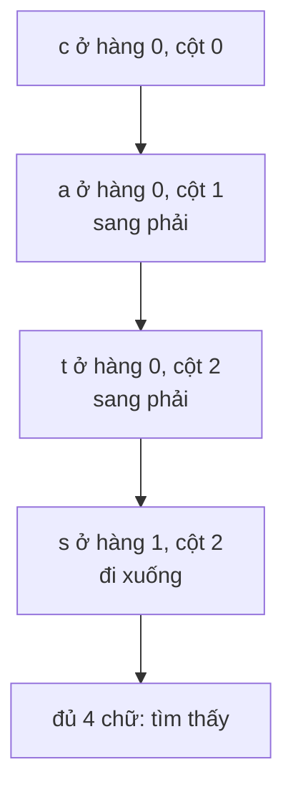
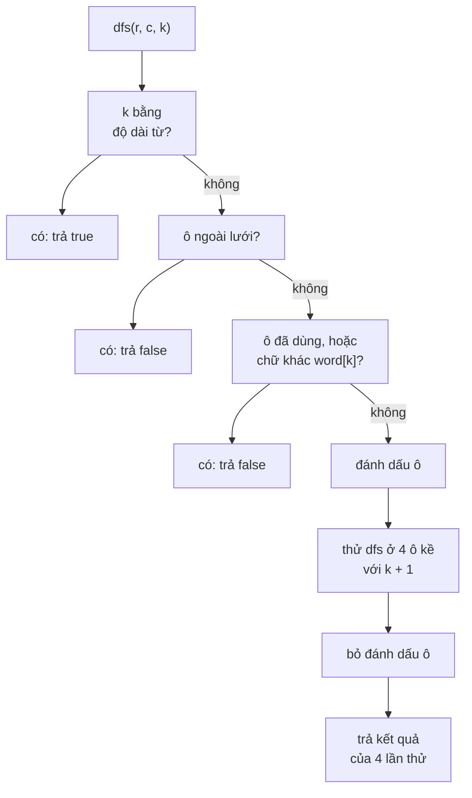

> [!tldr] Đọc nhanh
> - Mỗi ô của lưới có thể là chữ đầu tiên. Từ đó mình đi sang một ô kề cạnh có chữ kế tiếp, không được bước lại ô đã nằm trên đường đang đi.
> - Đây là [[concepts/backtracking|quay lui]] trên lưới: đánh dấu ô, thử bốn hướng, rồi [[concepts/visit-and-restore|trả ô về như cũ]] trước khi lùi lại. Quên bước trả lại thì một nhánh thất bại sẽ chặn mất nhánh đúng.
> - Có thể đánh dấu bằng một bảng `visited` riêng, hoặc ghi đè chính ô đó bằng `#` rồi ghi lại chữ cũ. Cách sau không tốn thêm bộ nhớ.
> - Hai phép cắt nhánh rẻ: đếm chữ trước, thiếu chữ nào thì trả `false` ngay; và đảo từ khi chữ cuối hiếm hơn chữ đầu, để có ít điểm xuất phát hơn. Trên một lưới bẫy, số lượt gọi giảm từ 5.172 xuống 20.

> [!info] Bối cảnh
> Đây là bài LeetCode 79 tại [[posts/2026-11-28-neetcode-permutations-search|ga MISC-02: Quay lui: hoán vị và tìm kiếm]] trên **tuyến NeetCode: Kỹ thuật tổng hợp**. Mình hình dung một tờ ô chữ in sẵn, và việc của mình là dò xem một từ có nằm trên đó theo một đường gấp khúc không. Bạn chỉ cần biết mảng hai chiều và hàm đệ quy.

> [!abstract]- Từ điển nhanh cho bài này (bấm để mở)
> - Ô kề cạnh là ô ngay trên, dưới, trái hoặc phải. Ô chéo không tính.
> - Đường đi đơn là đường không đi qua ô nào hai lần.
> - DFS (tìm theo chiều sâu) đi hết một hướng rồi mới quay lại thử hướng khác. Ở đây mỗi bước sâu hơn là thêm một chữ của từ.
> - [[concepts/grid-graph|Lưới như đồ thị]]: mỗi ô là một đỉnh, mỗi cặp ô kề cạnh là một cạnh.
> - [[concepts/choice-tree|Cây lựa chọn]] của bài này có gốc là ô xuất phát, mỗi tầng là một chữ, mỗi nhánh là một hướng đi.

## Hình dung trước: dò ô chữ bằng đồng xu

Mình có tờ ô chữ và một nắm đồng xu. Tìm chữ đầu tiên, đặt một đồng xu lên đó. Nhìn bốn ô quanh nó, ô nào có chữ kế tiếp và chưa có xu thì đặt xu tiếp. Đến chỗ kẹt thì nhấc đồng xu cuối cùng lên và thử hướng khác. Đặt đủ xu cho cả từ là tìm thấy.

| Đời thường | Khái niệm |
|---|---|
| Tờ ô chữ | Lưới `board` m × n |
| Ô đang đặt đồng xu | Ô nằm trên đường đang đi, không được dùng lại |
| Đặt xu, nhìn bốn ô quanh | Đánh dấu ô, gọi đệ quy cho bốn hướng |
| Nhấc xu khi kẹt | Trả ô về chữ cũ trước khi quay lui |
| Đặt đủ xu cho cả từ | `k` bằng độ dài từ, trả `true` |
| Đếm chữ trên tờ trước khi dò | Cắt nhánh theo tần suất chữ |
| Bắt đầu dò từ chữ hiếm hơn | Đảo từ khi chữ cuối ít hơn chữ đầu |

Lấy lưới tự đặt dưới đây. Từ `cats` đi `c → a → t`, rồi xuống `s`:

```text
c a t
o d s
g e n
```



## Vấn đề: có tìm được từ trên lưới không

Cho lưới m × n chữ cái tiếng Anh (hoa hoặc thường), với 1 ≤ m, n ≤ 6, và một từ dài 1–15 chữ. Trả `true` nếu có một đường đi đơn qua các ô kề cạnh mà các chữ trên đường ghép lại đúng bằng từ. Mỗi ô chỉ được dùng một lần trong một đường. Ví dụ trên lưới ở trên, `dog` có (`d → o → g`), còn `tact` thì không, vì lưới chỉ có một chữ `t`. [Đề gốc LeetCode 79](https://leetcode.com/problems/word-search/)

Mình từng nghĩ chỉ cần thấy chữ kế tiếp ở ô bên cạnh là đi luôn, không cần quay lại. Nhưng một ô có thể có hai ô kề cùng chữ. Chọn sai ô thì vài bước sau mới kẹt, và lúc đó phải lùi về thử ô còn lại.

## Cơ chế

### DFS với bảng visited

Hàm `dfs(r, c, k)` hỏi: có ghép được phần từ bắt đầu ở chữ thứ k, nếu đặt chữ đó ở ô (r, c) không? Thứ tự kiểm tra trong một lời gọi:



Vòng ngoài gọi `dfs(r, c, 0)` cho mọi ô. Kiểm tra biên phải đứng trước khi đọc `board[r][c]`, vì bốn hướng có thể đưa ra ngoài lưới.

Gọi L là độ dài từ. Có m·n điểm xuất phát. Ở bước đầu có 4 hướng, các bước sau chỉ còn tối đa 3, vì hướng vừa đi tới là ô đã đánh dấu. Thời gian là O(m·n·3^L) trong trường hợp xấu nhất. Ngăn xếp đệ quy sâu tối đa L + 1 tầng, cộng bảng `visited` O(m·n).

### Đánh dấu ngay trên lưới

Thay vì giữ bảng riêng, mình ghi đè ô đang dùng bằng `#`, một ký tự không bao giờ có trong từ, và giữ chữ cũ trong biến `saved`. Một ô `#` tự động không khớp với chữ nào, nên điều kiện "đã dùng" gộp vào phép so chữ. Trước khi trả về, dù tìm thấy hay không, mình ghi `saved` trở lại. Lưới trở về y nguyên sau mỗi lần tìm, và bộ nhớ thêm chỉ còn ngăn xếp O(L).

Đây là cùng một ý của [[concepts/visit-and-restore|đánh dấu rồi trả lại]]: trạng thái dùng chung chỉ được thay đổi trong lúc đang ở trên đường, và phải trả lại đúng như cũ khi rời đường.

### Cắt nhánh trước khi tìm

Hai bước rẻ trước vòng DFS:

1. Đếm số lần mỗi chữ xuất hiện trên lưới và trong từ. Nếu từ cần ba chữ `e` mà lưới chỉ có hai, trả `false` mà không cần đi bước nào. Phép đếm tốn O(m·n + L).
2. Nếu chữ cuối của từ xuất hiện ít hơn chữ đầu, đảo ngược từ rồi tìm. Một đường khớp từ theo chiều xuôi cũng khớp từ đảo theo chiều ngược, nên đáp án không đổi. Số điểm xuất phát thật sự (ô khớp chữ đầu) giảm xuống.

Phép đo trong file: lưới 4 × 4 toàn chữ `a`, chữ `b` ở góc dưới phải bị hai chữ `c` chắn, tìm `aaaaaaab`. Phép đếm vẫn qua vì lưới có một chữ `b`, nhưng không đường nào chạm được `b` từ một chữ `a`. Bản không cắt nhánh đi hết mọi đường bảy chữ `a` từ 13 ô xuất phát: 5.172 lượt gọi. Bản đảo từ thành `baaaaaaa` chỉ có một ô xuất phát, và cả bốn ô kề của nó đều sai chữ: 20 lượt gọi. Con số đếm cả các lời gọi dừng ngay ở kiểm tra biên, là số lần vào hàm, không phải thời gian chạy.

Khi phải tìm nhiều từ trên cùng một lưới, lặp lại DFS cho từng từ sẽ tốn. Bài [[problems/word-search-ii|Word Search II]] gom các từ vào một cây tiền tố và dò tất cả trong một lượt.

## Ví dụ chạy được

[TypeScript](../code/neetcode-word-search/search.ts) · [Python](../code/neetcode-word-search/search.py) · [Go](../code/neetcode-word-search/search.go) · [Java](../code/neetcode-word-search/search.java) · [JavaScript](../code/neetcode-word-search/search.js) · [PHP](../code/neetcode-word-search/search.php) · [Rust](../code/neetcode-word-search/word_search.rs)

```ts
function existInPlace(board: Board, word: string): boolean {
    const rows = board.length, cols = board[0].length
    function dfs(r: number, c: number, k: number): boolean {
        calls++
        if (k === word.length) return true
        if (r < 0 || c < 0 || r >= rows || c >= cols) return false
        if (board[r][c] !== word[k]) return false
        const saved = board[r][c]
        board[r][c] = '#'
        let found = false
        for (const [dr, dc] of DIRS) {
            if (dfs(r + dr, c + dc, k + 1)) {
                found = true
                break
            }
        }
        board[r][c] = saved
        return found
    }
    for (let r = 0; r < rows; r++) {
        for (let c = 0; c < cols; c++) {
            if (dfs(r, c, 0)) return true
        }
    }
    return false
}
```

```python
def exist_in_place(board, word):
    rows, cols = len(board), len(board[0])

    def dfs(r, c, k):
        global calls
        calls += 1
        if k == len(word):
            return True
        if r < 0 or c < 0 or r >= rows or c >= cols:
            return False
        if board[r][c] != word[k]:
            return False
        saved = board[r][c]
        board[r][c] = '#'
        found = False
        for dr, dc in DIRS:
            if dfs(r + dr, c + dc, k + 1):
                found = True
                break
        board[r][c] = saved
        return found

    return any(dfs(r, c, 0) for r in range(rows) for c in range(cols))
```

```go
func existInPlace(board [][]byte, word string) bool {
	rows, cols := len(board), len(board[0])
	var dfs func(r, c, k int) bool
	dfs = func(r, c, k int) bool {
		calls++
		if k == len(word) {
			return true
		}
		if r < 0 || c < 0 || r >= rows || c >= cols {
			return false
		}
		if board[r][c] != word[k] {
			return false
		}
		saved := board[r][c]
		board[r][c] = '#'
		found := false
		for _, d := range dirs {
			if dfs(r+d[0], c+d[1], k+1) {
				found = true
				break
			}
		}
		board[r][c] = saved
		return found
	}
	for r := 0; r < rows; r++ {
		for c := 0; c < cols; c++ {
			if dfs(r, c, 0) {
				return true
			}
		}
	}
	return false
}
```

```java
static boolean existInPlace(char[][] board, String word) {
    for (int r = 0; r < board.length; r++)
        for (int c = 0; c < board[0].length; c++)
            if (dfsInPlace(board, word, r, c, 0)) return true;
    return false;
}

static boolean dfsInPlace(char[][] board, String word, int r, int c, int k) {
    calls++;
    if (k == word.length()) return true;
    if (r < 0 || c < 0 || r >= board.length || c >= board[0].length) return false;
    if (board[r][c] != word.charAt(k)) return false;
    char saved = board[r][c];
    board[r][c] = '#';
    boolean found = false;
    for (int[] d : DIRS) {
        if (dfsInPlace(board, word, r + d[0], c + d[1], k + 1)) {
            found = true;
            break;
        }
    }
    board[r][c] = saved;
    return found;
}
```

```js
function existInPlace(board, word) {
    const rows = board.length, cols = board[0].length
    function dfs(r, c, k) {
        calls++
        if (k === word.length) return true
        if (r < 0 || c < 0 || r >= rows || c >= cols) return false
        if (board[r][c] !== word[k]) return false
        const saved = board[r][c]
        board[r][c] = '#'
        let found = false
        for (const [dr, dc] of DIRS) {
            if (dfs(r + dr, c + dc, k + 1)) {
                found = true
                break
            }
        }
        board[r][c] = saved
        return found
    }
    for (let r = 0; r < rows; r++) {
        for (let c = 0; c < cols; c++) {
            if (dfs(r, c, 0)) return true
        }
    }
    return false
}
```

```php
function existInPlace(array &$board, string $word): bool {
    $rows = count($board);
    $cols = count($board[0]);
    $dfs = function (int $r, int $c, int $k) use (&$dfs, &$board, $word, $rows, $cols): bool {
        global $calls;
        $calls++;
        if ($k === strlen($word)) return true;
        if ($r < 0 || $c < 0 || $r >= $rows || $c >= $cols) return false;
        if ($board[$r][$c] !== $word[$k]) return false;
        $saved = $board[$r][$c];
        $board[$r][$c] = '#';
        $found = false;
        foreach (DIRS as [$dr, $dc]) {
            if ($dfs($r + $dr, $c + $dc, $k + 1)) {
                $found = true;
                break;
            }
        }
        $board[$r][$c] = $saved;
        return $found;
    };
    for ($r = 0; $r < $rows; $r++) {
        for ($c = 0; $c < $cols; $c++) {
            if ($dfs($r, $c, 0)) return true;
        }
    }
    return false;
}
```

```rust
fn exist_in_place(board: &mut Vec<Vec<u8>>, word: &[u8]) -> bool {
    fn dfs(board: &mut Vec<Vec<u8>>, word: &[u8], r: i32, c: i32, k: usize) -> bool {
        tick();
        if k == word.len() {
            return true;
        }
        if r < 0 || c < 0 || r as usize >= board.len() || c as usize >= board[0].len() {
            return false;
        }
        let (ru, cu) = (r as usize, c as usize);
        if board[ru][cu] != word[k] {
            return false;
        }
        let saved = board[ru][cu];
        board[ru][cu] = b'#';
        let mut found = false;
        for (dr, dc) in DIRS {
            if dfs(board, word, r + dr, c + dc, k + 1) {
                found = true;
                break;
            }
        }
        board[ru][cu] = saved;
        found
    }
    for r in 0..board.len() {
        for c in 0..board[0].len() {
            if dfs(board, word, r as i32, c as i32, 0) {
                return true;
            }
        }
    }
    false
}
```

Các tab trích bản đánh dấu ngay trên lưới. File tải về còn có bản dùng `visited`, bản cắt nhánh và một bộ liệt kê làm trọng tài. Bộ liệt kê không nhìn chữ khi đi: nó sinh mọi đường đi đơn dài đúng bằng từ, ghép chữ trên đường rồi so cả chuỗi. Dòng thứ hai đối chiếu ba cách với nó trên mọi lưới 2 × 2 và 2 × 3 gồm chữ `a`, `b`, với mọi từ `a`/`b` dài 1–4, và kiểm tra lưới trở về như cũ sau mỗi lần tìm. Cả bảy ngôn ngữ in cùng kết quả:

```text
12/12 ca đúng
2400/2400 ca đúng (đối chiếu liệt kê mọi đường đi)
Lưới 4×4 toàn a, b ở góc bị c chắn, từ aaaaaaab: không cắt nhánh 5172 lượt gọi, đảo từ 20 lượt gọi
```

Chạy bằng `node search.ts`, `python3 search.py`, `go run search.go`, `java search.java`, `node search.js`, `php -d xdebug.mode=off search.php` hoặc `rustc --edition 2021 -O word_search.rs -o /tmp/word_search && /tmp/word_search`.

## Hiểu lầm và bẫy hay gặp

- **Quên trả ô về chữ cũ.** Mình đã chạy thử bản không có dòng trả lại trên lưới `aa / ab` với từ `aaab`. Đáp án đúng là `true` (đi `a` dưới trái → `a` trên trái → `a` trên phải → `b`). Bản quên trả lại để `#` trên các ô của nhánh thất bại đầu tiên, nên nhánh đúng không còn ô để đi và kết quả là `false`.
- **Đọc ô trước khi kiểm tra biên.** Bốn hướng từ ô ở mép trỏ ra ngoài lưới. Đọc `board[r][c]` trước thì Python lấy nhầm ô ở đầu kia khi chỉ số là −1, còn Java, Go và Rust dừng chương trình vì chỉ số vượt mảng.
- **Thoát sớm mà bỏ qua bước trả lại.** Khi tìm thấy, mình vẫn ghi `saved` về rồi mới trả `true`, nếu không thì lưới của người gọi bị để lại dấu `#`.
- **Tham lam theo hướng đầu tiên khớp.** Đi vào ô kề đầu tiên khớp chữ rồi không quay lại sẽ bỏ sót đường đúng. Mọi hướng khớp đều phải được thử.
- **Java:** `board[r][c]` là `char`, nên so với `word.charAt(k)` bằng `!=` là so giá trị. Nếu cắt chữ bằng `word.substring(k, k + 1)` thì được một `String`, và so `String` bằng `==` là so tham chiếu.
- **PHP:** mảng truyền vào hàm được chép, nên bản ghi đè nhận `array &$board` và closure dùng `use (&$board)`. Mình đã chạy thử bản closure bắt `$board` theo giá trị: mỗi lời gọi đánh dấu trên bản chép riêng của nó, lời gọi sâu hơn không thấy dấu, và từ `aba` trên lưới một hàng `a b` cho `true` dù chữ `a` bị dùng hai lần.
- **Rust:** hàm đệ quy nhận `&mut Vec<Vec<u8>>`. Không thể giữ một tham chiếu `&board[r][c]` trong lúc gọi đệ quy với `&mut board`, nên bản trong tab chép byte ra biến `saved` (kiểu `u8` chép được), ghi `#`, đệ quy, rồi ghi lại.
- **Python:** từ dài tối đa 15 chữ, nên đệ quy sâu tối đa 16 tầng, cách xa giới hạn mặc định 1.000 tầng.

## Câu hỏi tự kiểm tra

> [!question]- Vì sao các bước sau bước đầu chỉ có tối đa 3 hướng?
> Một trong bốn ô kề là ô vừa đi tới, đang được đánh dấu. Nó luôn thất bại ở phép so chữ, nên chỉ còn ba hướng có thể đi tiếp.

> [!question]- Vì sao đảo từ không làm đổi đáp án?
> Đi ngược một đường khớp `word` cho ra một đường khớp từ đảo, vẫn qua đúng các ô đó và vẫn không lặp ô. Hai câu hỏi có cùng câu trả lời; chỉ số điểm xuất phát khác nhau.

> [!question]- Ký tự đánh dấu phải thỏa điều kiện gì?
> Nó không được xuất hiện trong từ cần tìm. Đề chỉ dùng chữ cái tiếng Anh, nên `#` không bao giờ khớp với `word[k]`.

> [!question]- Khi nào nên chuyển sang cách của Word Search II?
> Khi phải tìm nhiều từ trên cùng một lưới. Một cây tiền tố cho phép mỗi lần DFS dò cùng lúc mọi từ có chung đầu, thay vì chạy lại một lần cho từng từ.

## Tham khảo

- [LeetCode 79](https://leetcode.com/problems/word-search/)
- [Jeff Erickson, Algorithms, chương Backtracking](https://jeffe.cs.illinois.edu/teaching/algorithms/book/02-backtracking.pdf)
- [PHP: anonymous functions và `use` theo tham chiếu](https://www.php.net/manual/en/functions.anonymous.php) · [Rust Book: references and borrowing](https://doc.rust-lang.org/book/ch04-02-references-and-borrowing.html) · [Java String.charAt](https://docs.oracle.com/en/java/javase/21/docs/api/java.base/java/lang/String.html#charAt(int))
